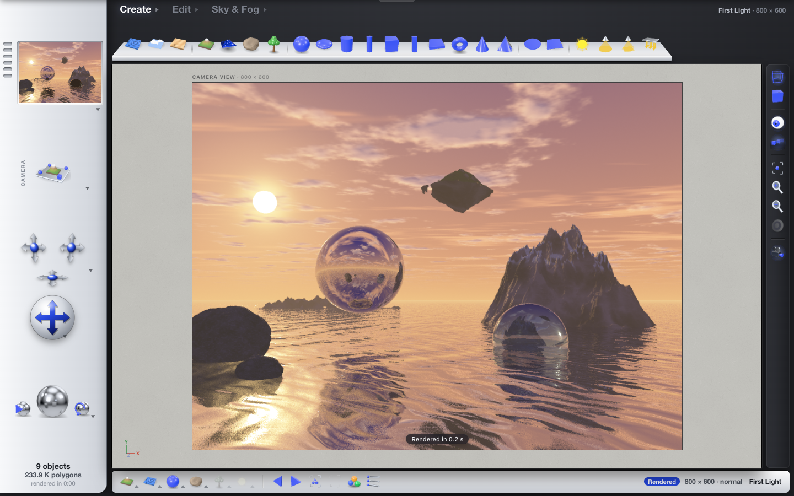

# Bryce 3D Web

An unofficial, browser-based homage to **Bryce 3D**, the 1994 landscape ray tracer behind a decade of
"alien floating world" album covers. Build a fractal island in a reflective sea, drop in a chrome sphere,
paint a surreal sky, hit **Render** and watch the picture resolve in Bryce's chunky mosaic passes.

Everything runs in your browser: a WebGL2 ray tracer, a three.js wireframe editor and a React interface
modeled on Bryce 4/5. No install, no backend, no account.

**[Play in your browser](https://at350.github.io/bryce3d/)** · [Source](https://github.com/at350/bryce3d)



## Features

- **Progressive ray-traced render** with Bryce's mosaic passes, anti-aliasing, soft shadows, mirror
  reflections, glass refraction, procedural textures, haze, fog and cloud layers.
- **Create palette**: water, cloud and ground planes, fractal terrains, symmetrical lattices, stones, trees,
  primitives (sphere, cube, cylinder, cone, torus, pyramid, disc, square) and lights.
- **Edit palette**: Bryce's drag-to-resize/rotate/reposition tools, align, randomize, duplicate.
- **Sky & Fog palette** and **Sky Lab**: sky modes, sun and moon trackball, stars, two cloud layers, haze,
  fog and shadows, with dozens of preset skies and a randomize button.
- **Materials Lab**: the channel grid (diffuse, ambient, specular, reflection, transparency, refraction, bump,
  ...) driven by up to three procedural texture components, plus a library of preset materials.
- **Terrain Editor**: generators (fractal, canyons, mesas, volcanoes, dunes, craters, erosion, ...), a height
  brush, filter curves, picture import and a live 3D preview.
- **Nano Preview**, camera crosses and trackball, memory dots, camera / director / orthographic views.
- **Libraries** of objects, materials, skies and sample scenes with rendered thumbnails.
- **Save / open** scenes as `.bryce.json`, **share links** that encode the scene in the URL, **PNG export**,
  autosave, undo/redo, keyboard shortcuts, and three interface skins (Bryce 2, Bryce 5, Bryce 7).

## Run it locally

```bash
npm install
npm run dev        # http://localhost:5173
npm test           # unit tests
npm run build      # production build in dist/
```

Requires a browser with WebGL2 (any current Chrome, Edge, Firefox or Safari).
Best on a desktop or laptop, with a window at least 1024 × 700.

Click an icon in **Create** to add an object, double-click a terrain to sculpt it, or select an object
and press **Ctrl/Cmd+M** to edit its material. The large chrome ball at lower left starts a render
(**Ctrl/Cmd+R**). Move the pointer to the top edge to reveal the menus; **File → Sample Scenes** opens
the scene gallery. Use **File → Share Link** to send someone a copy of your scene.

For the browser integration check, start the app or production preview in another terminal, then run
`npm run test:browser -- http://localhost:5173/`. This requires installed Google Chrome and checks the
labs, rendering, PNG encoding, scene download/open, share links, libraries and compact layout. It saves
screenshots and downloads under `/tmp/bryce-smoke`.

With the development server running, `npm run test:terrain -- http://localhost:5173/` checks terrain
intersections directly on the GPU, including steep Mosaic terrain and clipped surfaces.

The release stress scripts expect the development server at `http://localhost:5301/`
(`npm run dev -- --port 5301`). Run `node scripts/release-editor.mjs`,
`node scripts/release-labs.mjs`, `node scripts/release-renderer.mjs`, and
`node scripts/release-io.mjs` for the editor, worker/history races, GPU resource handling,
and file/share persistence checks. Their evidence is written under `/tmp/bryce-release-*`.

Tab and Shift+Tab move keyboard focus; `[` and `]` cycle scene objects. Object Attributes
uses a working copy: OK applies one undoable change, and Cancel discards it.

## Deploy

The build uses a relative base path, so `dist/` works at the root of a domain (Vercel, Netlify) and under a
sub-path (GitHub Pages).

- **GitHub Pages**: push to `main`; `.github/workflows/deploy.yml` lints, tests, builds and publishes.
  Enable Pages with "GitHub Actions" as the source in the repository settings.
- **Vercel**: import the repository (framework preset: Vite) or run `vercel --prod`.

## Project layout

```
src/core      scene data model, store (Zustand), math, camera ops: the contract between modules
src/render    WebGL2 progressive ray tracer
src/viewport  three.js working window (wireframes, selection, handles, views)
src/ui        palettes, controls, icons, menus, dialogs, shortcuts
src/labs      Materials Lab, Terrain Editor, Sky Lab
src/terrain   heightfield generators and operations
src/materials material presets and defaults
src/sky       sky presets and defaults
src/scenes    startup scene, sample scenes, object library
src/io        save, open, share links, autosave
docs/SPEC.md  the design spec
```

## Credits and disclaimer

Bryce was created by Phil Clevenger, Kai Krause, Sree Kotay and Eric Wenger, and later developed by
MetaCreations, Corel and DAZ 3D. This project is an independent fan homage: it is not affiliated with or
endorsed by DAZ 3D, and it contains no original Bryce code, artwork, icons or presets. "Bryce" is a
trademark of DAZ 3D.

MIT licensed. See [LICENSE](LICENSE).
